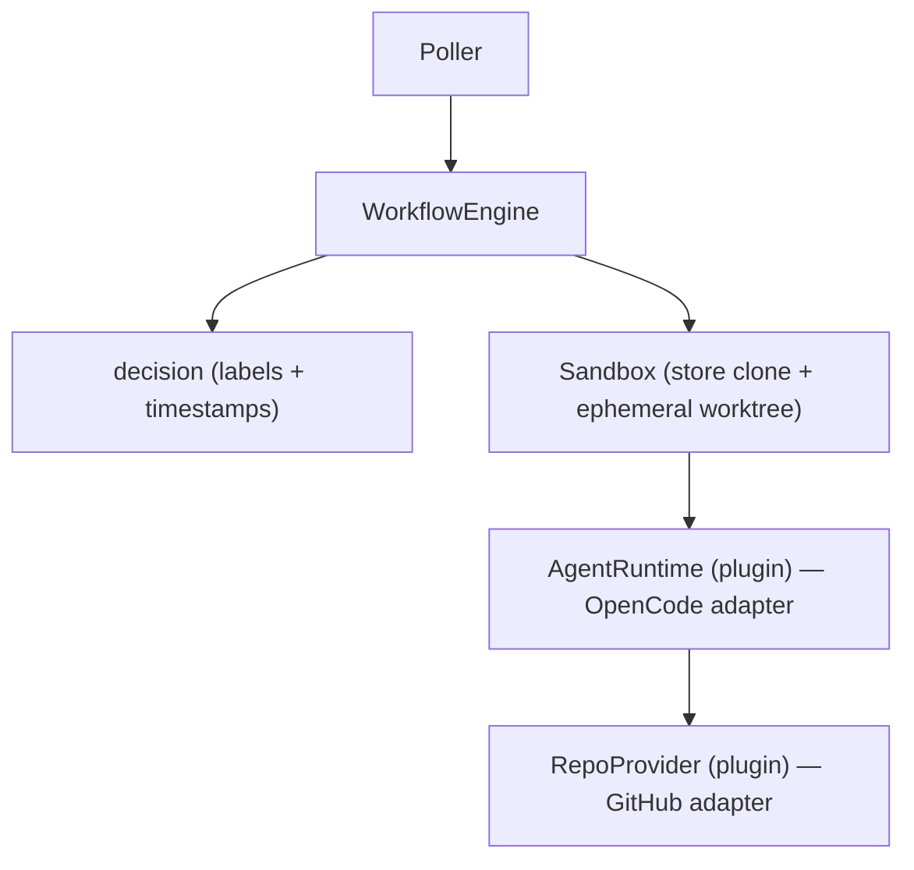

# openspec-workflow-orchestrator

A workflow orchestrator that turns a repository issue into a reviewed,
executable **OpenSpec** change and then implements it — with a human approval
gate in between. It connects to source hosts (GitHub first), polls them, and
drives the OpenSpec lifecycle from the issue's problem description.

## How it works

```mermaid
stateDiagram-v2
    state "PROPOSING (label)" as PROPOSING
    state "READY (label)" as READY
    state "IMPLEMENTING (label: claim)" as IMPLEMENTING
    state "DONE (change archived in the PR)" as DONE
    state "FAILED (label)" as FAILED
    [*] --> PROPOSING: issue + label "openspec"
    PROPOSING --> READY: propose turn passes readiness
    PROPOSING --> PROPOSING: feedback; still not ready
    READY --> PROPOSING: feedback; no longer ready
    READY --> READY: feedback; still ready
    READY --> IMPLEMENTING: approval
    IMPLEMENTING --> DONE: merged
    PROPOSING --> FAILED: turn failure, no progress, or revise limit
    READY --> FAILED: turn failure or revise limit
    IMPLEMENTING --> FAILED: apply turn failure
    FAILED --> PROPOSING: recovery (readiness re-evaluated)
    DONE --> [*]
```



The diagram is an overview: it draws the ordinary path and the common
failures, and omits detail (such as cancellation) to stay readable. The
reference below is the exhaustive authority for every state and transition, and
the narrative that follows walks through the same lifecycle.

### Workflow states and labels

The **trigger label** (`openspec` by default) is on the **issue**: an issue
carrying it opts into the workflow. The **current phase** is marked by a
lifecycle label on the **pull request**:

| Phase          | Lifecycle label         | Meaning                                                                                 |
| -------------- | ----------------------- | --------------------------------------------------------------------------------------- |
| `PROPOSING`    | `openspec:proposing`    | The change is being drafted or revised and a review is expected.                        |
| `READY`        | `openspec:ready`        | The change satisfies the readiness predicate; an approval starts implementation.        |
| `IMPLEMENTING` | `openspec:implementing` | The apply turn has been claimed and the workflow is in progress or awaiting merge.      |
| `DONE`         | `openspec:done`         | The pull request merged and the workflow is complete.                                   |
| `FAILED`       | `openspec:failed`       | The workflow stopped on a turn failure or the revise limit; recovery is attempted once. |

Setting a phase replaces any other phase label, so a pull request carries exactly
one phase label (or none, after cancellation), and cancelling a workflow clears
every phase label. All of these names are configurable through `labels`; see
[configuration](docs/configuration.md#labels).

### Workflow transitions

Each row is keyed by the state the workflow is in. "No turn" means the
orchestrator runs no agent turn, though it may still update labels or post a
comment.

| State                            | Trigger                                                                                                                                         | Next state        | Action                                                                                                                                                                                                                                                 |
| -------------------------------- | ----------------------------------------------------------------------------------------------------------------------------------------------- | ----------------- | ------------------------------------------------------------------------------------------------------------------------------------------------------------------------------------------------------------------------------------------------------ |
| (start)                          | The issue carries the trigger label and has no active pull request.                                                                             | PROPOSING / READY | Create a draft pull request (Conventional Commit title, `Closes #<issue>` body) and run a **propose** turn, then set READY or PROPOSING from readiness; a turn that commits nothing fails the workflow.                                                |
| PROPOSING                        | Reviewer feedback newer than the last turn (changes requested or a submitted review comment), with revise rounds left.                          | PROPOSING / READY | Run a **propose** turn: revise the change, push the branch, post a comment, then set READY or PROPOSING from readiness.                                                                                                                                |
| PROPOSING                        | An approval newer than the last turn, before the change is ready, with revise rounds left.                                                      | PROPOSING / READY | Run a **propose** turn (the approval arrived early); otherwise the same as a revise.                                                                                                                                                                   |
| PROPOSING                        | Reviewer feedback or an approval while the revise limit is reached.                                                                             | FAILED            | No turn. Set `openspec:failed` and post the failure comment.                                                                                                                                                                                           |
| PROPOSING                        | No new human activity (or an approval already answered).                                                                                        | PROPOSING         | No turn.                                                                                                                                                                                                                                               |
| PROPOSING                        | The revise propose turn fails: turn error, unresolved base merge, or a failed push.                                                             | FAILED            | No further turn. Set `openspec:failed` and post the failure comment with the turn's metrics.                                                                                                                                                           |
| READY                            | An approval.                                                                                                                                    | IMPLEMENTING      | Claim it: set `openspec:implementing`, then run an **apply** turn that implements the tasks and folds `openspec archive` into its final commit, pushes the branch, reconciles the title, marks the pull request ready for review, and posts a comment. |
| READY                            | Reviewer feedback newer than the last turn, with revise rounds left.                                                                            | PROPOSING / READY | Run a **propose** turn: it returns to PROPOSING if the change is no longer ready, or stays READY.                                                                                                                                                      |
| READY                            | Reviewer feedback while the revise limit is reached.                                                                                            | FAILED            | No turn. Set `openspec:failed` and post the failure comment.                                                                                                                                                                                           |
| READY                            | No new human activity.                                                                                                                          | READY             | No turn.                                                                                                                                                                                                                                               |
| READY                            | The revise propose turn fails: turn error, unresolved base merge, or a failed push.                                                             | FAILED            | No further turn. Set `openspec:failed` and post the failure comment with the turn's metrics.                                                                                                                                                           |
| IMPLEMENTING                     | The apply turn fails: turn error, unresolved base merge, a failed push, or marking the pull request ready for review fails.                     | FAILED            | No further turn. Set `openspec:failed` and post the failure comment with the turn's metrics.                                                                                                                                                           |
| IMPLEMENTING                     | New reviewer feedback or an approval.                                                                                                           | IMPLEMENTING      | No turn: implementation is in progress and the workflow waits for merge.                                                                                                                                                                               |
| IMPLEMENTING                     | No new human activity.                                                                                                                          | IMPLEMENTING      | No turn.                                                                                                                                                                                                                                               |
| DONE                             | Any later poll.                                                                                                                                 | DONE              | No turn: the workflow is complete and the poller no longer drives it.                                                                                                                                                                                  |
| FAILED                           | A later poll finds the open pull request once per process (phase `failed` or absent), or a `proposing` workflow whose branch carries no change. | PROPOSING / READY | Recover: run a **propose** turn, then set READY or PROPOSING from readiness; a turn that commits nothing fails the workflow.                                                                                                                           |
| PROPOSING / READY / IMPLEMENTING | The pull request merged.                                                                                                                        | DONE              | No turn. Set `openspec:done` and post "Merged. Workflow complete."                                                                                                                                                                                     |
| PROPOSING / READY / IMPLEMENTING | The trigger label was removed from the issue, or the pull request was closed without merge.                                                     | (cancelled)       | No turn. Clear every phase label and post a cancellation comment.                                                                                                                                                                                      |

### Lifecycle in detail

- An issue carrying the trigger label starts a workflow: one branch and one
  draft pull request carrying an OpenSpec change.
- The agent runs **bounded turns**: a propose turn drafts/revises the change,
  reading the whole review transcript each time; a submitted review triggers a
  revise turn; an approval is the gate; plain comments do nothing.
- A propose turn that runs without a reviewer trigger is expected to produce the
  change. One that commits nothing did no work, so it fails the workflow
  (recoverable once per process) rather than leaving the pull request parked in
  `openspec:proposing`, where no review would ever drive it again. A workflow
  found parked in `openspec:proposing` whose branch carries no change at all is
  likewise recovered: the propose turn is re-run once per process, so it either
  produces the change or fails and reports on the pull request.
- **READY** is computed objectively from `openspec status --json` and
  `openspec validate --strict`, never from agent prose.
- On approval the orchestrator claims the approval (label `openspec:implementing`)
  _before_ running the apply turn, so a later push cannot re-trigger apply.
- The apply turn implements the tasks and folds `openspec archive` into its
  final commit. Once its commits are published, the orchestrator marks the pull
  request **ready for review**, releasing it from draft so a human can review and
  merge it; on GitHub this uses the `markPullRequestReadyForReview` GraphQL
  mutation, because no REST endpoint exposes the transition. A release that fails
  marks the workflow failed rather than leaving a task-complete pull request
  stuck in draft.
- Merging the PR completes the workflow. The draft pull request title is a
  Conventional Commit subject of the form `<type>(<scope>): <summary>`, so the
  subject the host derives from it on a squash merge follows the project
  convention. The type and optional scope are deduced from the issue context: a
  conventional issue title (for example `fix: ...` or `docs(api): ...`) wins;
  otherwise the type comes from the issue's labels (matched case-insensitively,
  defaulting to `feat`) and there is no scope. The summary is the issue title
  compacted to the project's 72-character commit-subject limit without rewriting
  its words. At the end of a successful apply turn the title is reconciled with
  the Conventional Commit subjects that turn committed, so an agreed applied type
  and a clear applied scope replace the deduced ones. Its body carries only the
  `Closes #<issue>` reference, so merging it into the host's default branch closes
  the issue automatically (the host only closes issues for merges into its default
  branch).

There is no database: phase lives in host labels, and the watermark is the
timestamp of the last human review versus the orchestrator's last turn comment.
The service polls (outbound-only) and can restart at any time without
duplicating work.

## Architecture



Two seams isolate everything external:

- **`RepoProvider`** — issues, comments, labels, pull requests, review state,
  clone, fetch, push, releasing a pull request from draft, and updating its title.
  A GitHub adapter ships first; GitLab is an extension point.
- **`AgentRuntime`** — runs exactly one OpenSpec skill (`propose` or `apply`) per
  turn in a sandbox and returns a structured result.

### Repository store and worktrees

The orchestrator keeps a persistent clone of each repository at
`<workspace.root>/<owner>/<name>` (default `~/workspace`), created on the first
turn and refreshed with `git fetch` before each later turn. Every turn then runs
in a throwaway `git worktree` of that clone, checked out on the workflow branch
and created under `<workspace.worktrees>` (default the OS temp directory). The
worktree is removed when the turn ends, so turns stay isolated while the clone
is reused.

Because the base branch keeps moving while a change is in flight, provisioning
also merges the current base branch into the workflow branch: a clean merge is
committed, and a conflicted merge is deliberately left in the worktree for the
turn to resolve. A turn that finishes without the base integrated is failed
(naming the base branch) rather than pushing a stale branch, and a branch left
behind by an earlier attempt is not reused when a workflow starts. See
[docs/configuration.md](docs/configuration.md) for the `workspace` fields.

## Requirements

- Node.js 24+ and git
- The `openspec` CLI on `PATH` (used for the readiness predicate)
- A container runtime (Docker) if any repository configures a turn
  [`environment`](docs/configuration.md#environment)
- An agent runtime (see [Agent runtime](#agent-runtime)); the shipped one embeds
  OpenCode, so no separate OpenCode server is needed

## Install and build

```bash
npm install
npm run build
```

## Configure

The service is single-tenant and config-driven. See
[docs/configuration.md](docs/configuration.md) for every field and default.

```yaml
# Values shared by every repository; each entry states only what differs.
defaults:
  provider: github
  owner: acme
  credential: env:GITHUB_TOKEN
  baseBranch: main
  pollIntervalSeconds: 60
  maxReviseRounds: 3
  labels:
    trigger: openspec
repositories:
  - name: widget
  - name: gadget
    baseBranch: develop
limits:
  maxSteps: 200
  maxTokens: 200000
  maxDurationMs: 1800000
workspace:
  root: ~/workspace
  worktrees: /tmp
logging:
  verbose: false
```

A copy of this example lives at [`examples/config.yaml`](examples/config.yaml).
The optional `defaults` block supplies values for entries that omit them; each
entry wins over `defaults`, which wins over the documented built-in default, and
`labels` merge key by key. `name` is never defaulted because it identifies the
repository. See [docs/configuration.md](docs/configuration.md#defaults).

Credentials are references (`env:NAME` or `gh:token`); secrets are never stored
in the config. The GitHub provider calls the API and clones through the `gh`
CLI, so authentication can come from an environment variable or from `gh auth
login`. Startup fails fast, naming the repository, when a credential reference
is missing or cannot be resolved.

Set `logging.verbose: true` (or pass `--verbose`) to emit per-poll-cycle and
per-turn diagnostics for troubleshooting. Diagnostics go to standard error and
never include credential values, so the concise default and the `--once` report
on standard output are unchanged when verbosity is off.

## Run

The GitHub provider requires the [`gh` CLI](https://cli.github.com/) on `PATH`:

```bash
gh auth login   # once; or provide GITHUB_TOKEN instead

# one poll cycle across every repository, then exit
node dist/run.js --config config.yaml --once

# long-running poller (polls each repository on its interval)
node dist/run.js --config config.yaml

# verbose diagnostics (per-poll-cycle and per-turn) on standard error
node dist/index.js --config examples/config.yaml --verbose

# a token in the environment still takes precedence for env: references
GITHUB_TOKEN=... node dist/run.js --config config.yaml
```

`dist/run.js` supplies the embedded OpenCode runtime. `dist/index.js` is the
stock CLI without one: it uses an `UnconfiguredRuntime` that fails loudly on the
first turn, which is what the fake-provider smoke test below relies on.

`dist/run.js` runs each turn in-process unless its repository configures an
`environment`, in which case the turn runs in a container of that image. That
path needs Docker on `PATH` and an image that meets the
[image contract](environments/README.md#image-contract); the orchestrator mounts
its compiled runner and the repository paths itself, so no image rebuild is
needed when the orchestrator changes.

### Entry points

The package ships two entry points over the same CLI (`--config`, `--once`,
`--verbose`, `--help`):

- **`dist/run.js`** — the deployable entry point. It supplies the embedded
  OpenCode runtime, so turns actually run. The `orchestrator` bin points here.
- **`dist/index.js`** — the runtime-agnostic `main` CLI. It supplies no runtime,
  so `UnconfiguredRuntime` **fails loudly** on the first turn; it backs the
  fake-provider smoke test below and is the entry point the tests import.

Run the service with `dist/run.js` (or the `orchestrator` command).

Label an issue with `openspec` to start a workflow. Lifecycle labels
`openspec:proposing`, `openspec:ready`, `openspec:implementing`,
`openspec:done`, and `openspec:failed` are managed on the pull request.

### Local smoke test

The built-in `fake` provider keeps everything in memory so you can confirm the
service starts without any network access:

```yaml
repositories:
  - provider: fake
    owner: acme
    name: widget
    credential: env:ANY_VALUE
```

```bash
ANY_VALUE=1 node dist/index.js --config fake.yaml --once
```

## Agent runtime

Turns run through an `AgentRuntime`. The shipped **OpenCode adapter** runs the
OpenSpec `propose` and `apply` skills, and is written against a narrow
`OpenCodeClient` interface. `dist/run.js` wires in the embedded client, which
hosts OpenCode **inside the orchestrator process** through `@opencode/sdk` — no
separate OpenCode server, port, or `OPENCODE_URL` to run. The host is created on
the first turn, gives each turn its own session at the turn workspace, and is
closed when the service stops.

When a repository configures an
[`environment`](docs/configuration.md#environment), its turns instead run in a
container of that image: the agent loop, the shell and file tools, `git`, and
`openspec` all execute there. The orchestrator mounts the repository store and
the turn worktree at their identical host paths (so the worktree's `.git`
pointer resolves), runs the container as the orchestrator's uid/gid with a
writable `HOME` and a git identity, passes provider credentials by name from the
environment, and mounts its compiled runner read-only at `/opt/runner/dist`. The
image must provide Node.js 24+, git, the toolchain, and `@opencode/sdk` at the
orchestrator's version; the runner fails fast on a version mismatch. The host
still publishes the branch, gates on merge readiness, and evaluates readiness.
See [`environments`](environments/README.md) for the image contract and the
flavours CI publishes to GHCR, and
[`docs/configuration.md`](docs/configuration.md#environment) for the fields.

`@opencode/sdk` uses explicit resource management and therefore requires
**Node.js 24+** (Node 22 cannot load it).

The host runs each turn on the model in the `agent` configuration block
(`agent.model`, default `greenpt/deepseek-v4.1-flash`) and authenticates with the
provider's API-key environment variable (for example `GREENPT_API_KEY`); set
`agent.database` (or `OPENCODE_DB`) only to reuse the `opencode` CLI's stored
auth, and never point it at a database a running OpenCode service is using.
After a turn succeeds the orchestrator pushes the workflow branch itself, so the
turn's commits appear on the pull request; a turn that errors, a propose turn
that commits nothing, or a push that fails, marks the workflow failed instead of
advancing it.

Every comment the orchestrator posts carries a compact metrics line for the turn
behind it: the model that ran the turn and the tokens it consumed broken down by
kind (input, output, reasoning, and cache read and write) with their total, the
wall-clock time the orchestrator measured, and the number of attempts the turn
took (a retried turn reports more than one). The adapter reads the model and
token counts from the turn's own session messages; the orchestrator measures the
elapsed time and attempts itself, so even a runtime that reports no duration is
covered. Values the runtime does not report are stated as `unknown` rather than
omitted. A comment for a transition with no turn behind it (workflow completion,
cancellation, or the revise limit) repeats the last turn's metrics, labelled as
the last turn's, recovered from a machine-readable marker on the earlier comment
so a restart still reports them.

When building the service yourself, supply a runtime when calling `createService`
in `src/service.ts`; the `OpenCodeRuntime` in `src/runtime/opencode/` is the
adapter, and `createEmbeddedHostFactory` in `src/runtime/opencode/sdk-host.ts`
provides the embedded host. Without a runtime the service uses an
`UnconfiguredRuntime` that **fails loudly** the first time a turn runs rather
than silently doing nothing.

## Deploy

The service is a stateless, outbound-only poller: it needs no inbound ports,
no webhooks, and no database, so it runs identically on a laptop, a VM, or in a
cluster.

- Provide credentials via the environment (a secret manager is fine).
- Run on **Node.js 24+**; OpenCode is embedded in the process, so there is no
  separate OpenCode server to deploy or port to open.
- Give it the `openspec` CLI and git on `PATH`.
- Give it a writable workspace root (default `~/workspace`) for the persistent
  per-repository clones, plus a writable temp directory for turn worktrees.
- For containerized turns, make Docker available and build each repository's
  [`environment`](docs/configuration.md#environment) image per the
  [image contract](environments/README.md#image-contract); the orchestrator
  mounts its compiled runner and the repository paths itself.
- Restart freely: on start it re-discovers in-flight workflows from their
  lifecycle labels and resumes without duplicating turns.

## Testing

```bash
npm test                  # unit + integration (fakes; no network)
npm run test:coverage     # as above, plus coverage/lcov.info
npm run lint
npm run typecheck
npm run format:check      # Prettier: is the tree formatted?
npm run format            # Prettier: rewrite the tree in place
```

The end-to-end tests cover the full lifecycle against fakes and verify that
`openspec archive` folds a change's requirements into the main specs.

Formatting is [Prettier](https://prettier.io), configured in `.prettierrc.json`
(100 columns, single quotes). `.prettierignore` keeps the formatter out of
`openspec/`, `dist/`, and `package-lock.json`; ESLint defers to Prettier for
layout via `eslint-config-prettier`.

`npm run verify` runs the whole gate — format check, lint, typecheck, tests, and
OpenSpec validation — and is what both the git hook and CI invoke. The gate's
test run collects coverage only when `COVERAGE=true`, which CI sets so that its
single run writes the `coverage/lcov.info` its code-analysis step consumes;
locally the gate stays coverage-free. Use `npm run test:coverage` for ad-hoc
coverage collection.

### Git hooks

`npm install` wires a tracked pre-commit hook (it sets `core.hooksPath` to
`.githooks`). Every commit first rewrites the staged files with Prettier and
re-stages them, so a commit can never land unformatted code; only the paths in
that commit are touched. Then it runs `npm run verify`: the format check, lint,
typecheck, the unit and integration tests, and `openspec validate --strict`
across the specs, the in-progress change, and the archived changes. Bypass it
with `git commit --no-verify` only when you know why.

CI (`.github/workflows/ci.yml`) runs the same gate on every pull request and on
pushes to `main`.

## Project layout

```
src/
  config/         configuration model, loader, credential resolution
  domain/         core domain types (events, phases, turns)
  provider/       RepoProvider seam, GitHub adapter, fake, contract suite
  runtime/        AgentRuntime seam, repository store, sandbox, limits, policy, OpenCode adapter
  orchestrator/   poller, engine, decision, readiness, labels
  service.ts      composition root
  index.ts        CLI
docs/             operator documentation
environments/     turn environment images published to GHCR
examples/         example configuration
```
