# Design

## Context

See `proposal.md` - Why. The README under "How it works" currently has a Mermaid
lifecycle diagram with four phases and a short bullet list. The authoritative
behavior lives in `src/orchestrator/decision.ts` (which action a phase and the
latest human review produce), `src/orchestrator/engine.ts` (what each action
does, including label changes and comments), `src/orchestrator/poller.ts`
(discovery and recovery), `src/orchestrator/labels.ts` (phase labels), and the
defaults in `src/config/types.ts`.

Two facts the current text leaves implicit:

- The **trigger** label (`openspec` by default) is on the **issue**, while the
  **phase** labels (`openspec:proposing`, `openspec:ready`,
  `openspec:implementing`, `openspec:done`, `openspec:failed`) are on the
  **pull request**. The engine replaces all other phase labels when it sets one,
  so at most one is present; cancellation clears them all.
- The diagram carries an `IMPLEMENTING --> PROPOSING: new feedback` edge that
  the orchestrator does not implement: the decision function idles in
  IMPLEMENTING, so feedback on the implementation pull request runs no turn
  while the workflow waits for merge.

## Goals / Non-Goals

**Goals:**

- A reader can look up any phase and see every trigger that applies there, the
  phase it leads to, and the exact action the orchestrator runs.
- The trigger label, the phase labels, and their configurability are explained
  where the diagram is.
- The diagram and the reference agree; where the diagram simplifies, the table
  is the exhaustive authority.

**Non-Goals:**

- Changing orchestrator behavior, code, configuration, or dependencies.
- Moving the lifecycle documentation to a separate page or site.
- Adding a build step, Mermaid renderer, or automated documentation check.
- Changing the `workflow-orchestration` or `project-documentation` behavior
  beyond what the README must show.

## Decisions

### Decision: put the reference in `README.md` next to the diagram

The issue targets the state diagram, and the README is where it lives. Keeping
the table directly under the diagram means a reader does not have to hold one
page in mind while reading another. Alternatives: a new
`docs/workflow-states.md` (rejected: splits the diagram from the reference and
adds a navigation hop); extending `docs/configuration.md` (rejected: that page
documents configuration, not lifecycle behavior).

### Decision: one table keyed by the current state

Use columns **State**, **Trigger**, **Next state**, and **Action**, with the
rows grouped by the current state (PROPOSING, READY, IMPLEMENTING, DONE,
FAILED). This answers the issue's "transitions per state" directly and makes it
obvious that the same event can have different outcomes depending on the state
(for example an approval while PROPOSING revises, while READY applies). Rows for
"no new human activity" state that no turn runs.

Alternatives: a single event table independent of state (rejected: hides that
behavior depends on the state, which is the main source of confusion); prose
only (rejected: harder to scan and compare).

### Decision: a separate phase-label reference

Add a short table mapping each phase to its default lifecycle label and meaning,
and state that the trigger label is on the issue, the phase label is on the pull
request, exactly one phase label is present, and all names are configurable via
`labels`. Alternatives: fold labels into the transition table (rejected: a label
describes a state, not a transition, and repeating it per row adds noise).

### Decision: correct the diagram instead of documenting a contradiction

Remove the impossible `IMPLEMENTING --> PROPOSING: new feedback` edge and show
the transitions the orchestrator performs, including failure and recovery.
Because the diagram is an overview, it MAY omit detail (such as cancellation),
but it MUST NOT show an edge the table does not list. The table remains the
exhaustive reference. The intended shape:

```mermaid
stateDiagram-v2
    state "PROPOSING (label)" as PROPOSING
    state "READY (label)" as READY
    state "IMPLEMENTING (label: claim)" as IMPLEMENTING
    state "DONE (change archived in the PR)" as DONE
    state "FAILED (label)" as FAILED
    [*] --> PROPOSING: issue + label "openspec"
    PROPOSING --> READY: propose turn passes readiness
    PROPOSING --> PROPOSING: feedback; still not ready
    READY --> PROPOSING: feedback; no longer ready
    READY --> READY: feedback; still ready
    READY --> IMPLEMENTING: approval
    IMPLEMENTING --> DONE: merged
    PROPOSING --> FAILED: turn failure, no progress, or revise limit
    READY --> FAILED: turn failure or revise limit
    IMPLEMENTING --> FAILED: apply turn failure
    FAILED --> PROPOSING: recovery (readiness re-evaluated)
    DONE --> [*]
```

Cancellation (trigger label removed, or pull request closed without merge)
clears the phase labels and ends the workflow; it is listed in the table and
explained in the prose rather than drawn, because every phase can be cancelled.

Alternatives: leave the existing diagram and only add the table (rejected: the
documentation would still assert a transition that never happens); draw every
failure and cancellation edge (rejected: the overview becomes harder to read
than the table it summarises).

### Decision: derive the table from the decision and engine code, not from prose

Each row is checked against `decide()` in `src/orchestrator/decision.ts` and the
`perform()`/`runTurn()` transitions in `src/orchestrator/engine.ts`, with
discovery and recovery from `src/orchestrator/poller.ts`. This keeps the
reference grounded in what the service does rather than in the old diagram.

## Risks / Trade-offs

- [The table drifts from the code when behavior changes] -> The reference sits
  beside the diagram in the same section, names the turns and label operations
  explicitly, and is derived from the decision and engine modules, so a behavior
  change is a small, local edit.
- [The implementing-idle behavior may be a defect rather than intended] -> This
  change documents current behavior only; if it should change, that is a
  separate behavior change that updates the code, the table, and the diagram
  together (see Open Questions).
- [A very detailed table makes the README long] -> Rows stay terse (trigger,
  next state, action) and the prose keeps the narrative; detail that does not
  affect the transition (comment contents, metrics) stays in the existing
  bullets.
- [A diagram self-loop or failure edge renders confusingly] -> Keep the diagram
  small and verify it in a Mermaid-capable preview; the table carries the
  detail.

## Migration Plan

None. A documentation-only change; it is picked up on the next merge. Rollback
is a revert.

## Open Questions

- Should new feedback submitted while a workflow is IMPLEMENTING drive a propose
  turn? The code currently idles in IMPLEMENTING and waits for merge, and this
  change documents that. If the intended behavior is to return to PROPOSING,
  that is a separate behavior change; the table and diagram should change with
  it.
