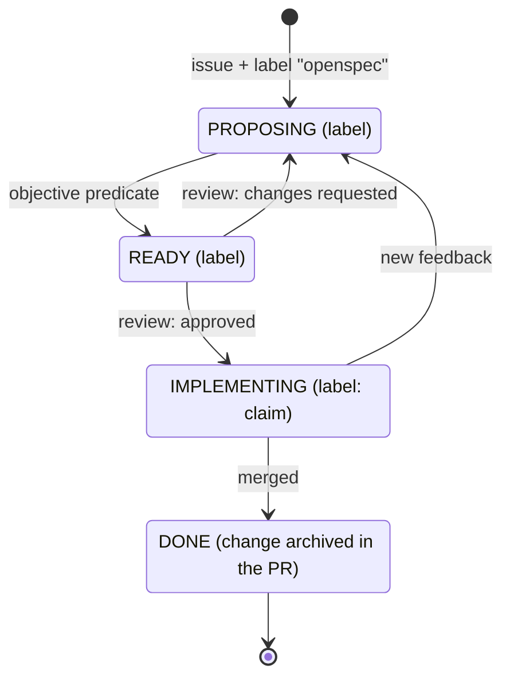
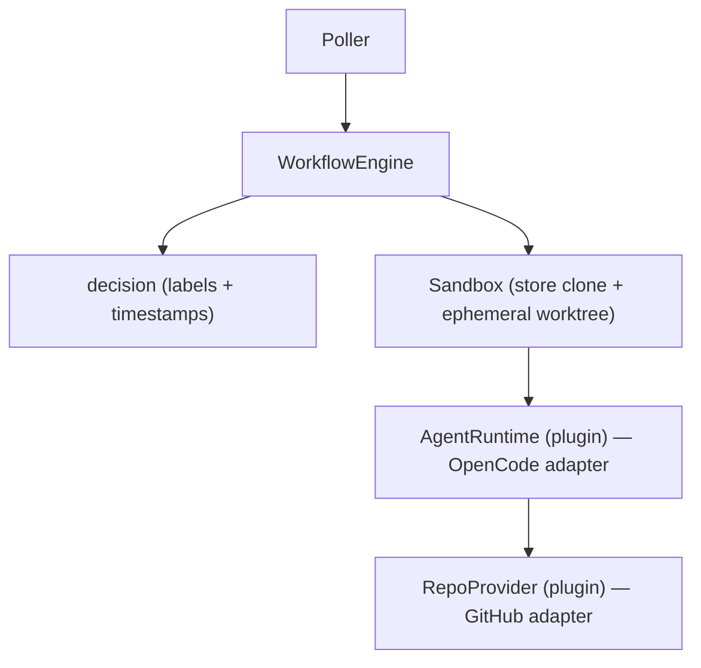

# Design

## Context

See `proposal.md` - Why. `README.md` carries two character-based diagrams:

- **"How it works"** draws the lifecycle with `+---+` boxes and `|`/`v` arrows:
  `PROPOSING` -> `READY` on the objective predicate, `READY` -> `PROPOSING` on
  "review: changes requested", `READY` -> `IMPLEMENTING` on "review: approved",
  `IMPLEMENTING` -> `PROPOSING` on new feedback, and `IMPLEMENTING` -> `DONE` on
  merge.
- **"Architecture"** draws the pipeline inside one `+---+` frame: `Poller` ->
  `WorkflowEngine`, the `WorkflowEngine` -> `decision (labels + timestamps)`
  edge, and `WorkflowEngine` -> `Sandbox (store clone + ephemeral worktree)` ->
  `AgentRuntime (plugin) -- OpenCode adapter` -> `RepoProvider (plugin) --
  GitHub adapter`.

The repository is hosted on GitHub, which renders `mermaid` fenced code blocks
in Markdown. The README is also read in plain editors, so the diagram source
should stay legible as text.

## Goals / Non-Goals

**Goals:**

- Every graph-like character diagram in `README.md` becomes a Mermaid diagram
  that GitHub renders, preserving the nodes, edges, and labels of the original.
- The surrounding prose keeps standing on its own, so a reader without Mermaid
  rendering loses only the picture.

**Non-Goals:**

- Rewriting the README's prose, structure, or terminology.
- Introducing Mermaid where there is no graph: the "Project layout" block is a
  directory tree and stays a text listing.
- Changing `docs/configuration.md`, the behavior of any existing capability, or
  any archived change. The change does add one documentation capability spec
  (see below), because the readiness predicate requires a completed specs
  artifact.
- Adding a Mermaid build step, runtime dependency, or CI rendering check.

## Decisions

### Decision: fenced `mermaid` blocks in `README.md`

Use GitHub's supported ```` ```mermaid ```` fenced code blocks, so the host
renders them with no build step. Alternatives: keep the character diagrams
(rejected: the issue asks for Mermaid, and they are hard to maintain); link to
externally hosted images (rejected: untracked, un-reviewable, and needs a render
service).

### Decision: a state diagram for the lifecycle, a flowchart for the architecture

The lifecycle is a state machine, so model it with `stateDiagram-v2`: each phase
is a state and each event is a labelled transition. The architecture is a
pipeline of components, so model it with `flowchart TD`: each component is a node
and each call is an edge. The intended shapes:





Alternatives: `flowchart` for both (rejected: the lifecycle reads as transitions
between phases, which `stateDiagram-v2` expresses directly); `sequenceDiagram`
(rejected: the original shows process phases, not messages over time).

### Decision: keep the "Project layout" tree as a text listing

The project layout is a directory listing, not a relationship graph. Mermaid has
no faithful tree/`ls` representation, and forcing it into nodes and edges would
be harder to read than the tree, so it stays a fenced text block. It is the only
character block left in the README after this change.

### Decision: record the contract as a `project-documentation` capability

The objective readiness predicate marks a change READY only when every artifact
is `done`. A change that sets `skip_specs: true` reports its specs artifact as
`skipped`, not `done`, so the predicate never passes and the workflow stays in
PROPOSING even after a reviewer approves it. This change therefore states the
documentation concern as a real capability, `project-documentation`, so the
specs artifact is `done` and the change can reach READY. Alternatives: keep
`skip_specs` (rejected: the approval gate can never open for this change); make
the readiness predicate treat `skipped` as satisfied (rejected here: that is
orchestrator behavior outside this documentation change, and worth its own
change because `skip_specs` is otherwise a legitimate OpenSpec marker).

### Decision: no automated render check

There is no Mermaid renderer in the toolchain and no network in CI, so the change
lands no Mermaid build or lint step. Adding one would pull a Node + headless
browser dependency in for a two-diagram documentation change. Verification is
observable instead: the diagrams render on GitHub (or a local Mermaid preview)
without a syntax error, and `npm run verify` still passes.

## Risks / Trade-offs

- [A renderer without Mermaid support shows the raw source] -> the source stays
  readable and the prose stands alone; GitHub, the primary host, renders it.
- [A Mermaid syntax error shows an error box instead of the diagram] -> keep the
  diagrams small and verify them in a Mermaid-capable preview before merging.
- [The lifecycle or architecture changes later and the diagram drifts] -> each
  diagram is one contiguous `mermaid` block next to the prose it illustrates, so
  keeping it current is a single local edit.
- [A reviewer expected the "Project layout" tree to convert too] -> it is called
  out as a Non-Goal with the reason; convert it only if review asks.
- [A documentation change with no real behavior change carries a capability spec
  it might not otherwise have] -> the capability covers only observable README
  requirements, and the alternative (`skip_specs`) cannot satisfy the readiness
  predicate; a follow-up change can teach the predicate to accept `skipped`.

## Migration Plan

None. A documentation-only change with no runtime effect; it is picked up on the
next merge. Rollback is a revert.

## Open Questions

None.
